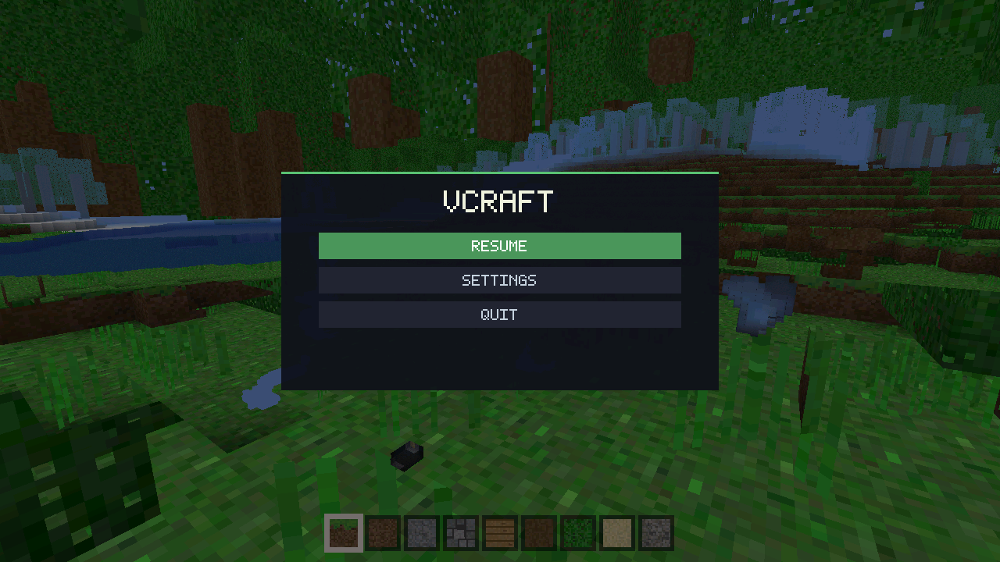
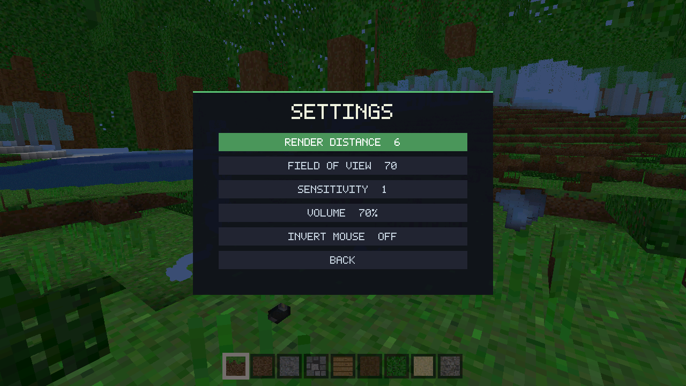

# VCraft

[](https://github.com/vlang/awesome-v)

A small Minecraft-like voxel sandbox written entirely in [V](https://vlang.io).
Procedural terrain, biomes, water, mining/building, a hotbar, a pause menu with
settings, and procedurally generated sound effects — no Mojang assets, all
textures, the bitmap font, and every sound are generated at startup.






> **Disclaimer:** VCraft has only been tested on **CachyOS / Arch Linux**. It
> links against the system SDL2, EGL, OpenGL, and zlib libraries, so it may run
> on other modern Linux desktops, but nothing else has been verified. No
> Windows or macOS builds.

## Download

Direct download — grab the latest AppImage and run it:

```sh
wget https://github.com/gabytz777/vcraft/releases/latest/download/vcraft-x86_64.AppImage
chmod +x vcraft-x86_64.AppImage
./vcraft-x86_64.AppImage
```

More builds on the [releases page](https://github.com/gabytz777/vcraft/releases/latest).
Releases are cut by hand: a workflow builds the AppImage into a **draft** release,
which is published only after it has been tried — so `latest` always points at the
newest version you actually approved.

> **Note:** GitHub downloads the file *without* the execute flag, so double-clicking
> may do nothing. If that happens, run the two commands above in a terminal.

## Build from source

Requires V (with the `gcc` backend) and the `SDL2`, `EGL`, `OpenGL`, and `zlib`
development packages. On Arch / CachyOS:

```sh
sudo pacman -S base-devel sdl2 mesa zlib   # then install V from vlang.io
git clone https://github.com/gabytz777/vcraft.git
cd vcraft
./build.sh          # -> build/vcraft
./build/vcraft
```

To produce your own AppImage:

```sh
./package.sh        # -> dist/vcraft-x86_64.AppImage
```

## Controls

- **WASD** move, **mouse** look, **LMB** break, **RMB** place
- **1–9** hotbar, **[** / **]** to cycle blocks
- **space** jump, **shift** sneak, **ctrl** sprint, **F** fly
- **Esc** opens the pause menu (Resume / Settings / Quit); the world freezes and
  the mouse is released

In the menu: **↑ ↓** / **W S** or the mouse to pick a row, **← →** / **A D** to
change a setting, **Enter** to activate. Settings (render distance, FOV, mouse
sensitivity, volume, invert mouse) are saved to `~/.config/vcraft/settings.cfg`
and reloaded on the next launch; set `VCRAFT_CONFIG` to keep them elsewhere.

## Sound

All audio is synthesised in V and played through SDL2's audio queue, so it needs
no new dependency and ships no audio files. Breaking, placing, footsteps,
jumping, landing, splashing, and menu blips each have a short generated waveform,
scaled by the volume setting. If no audio device is available the game simply
runs silently.

## How it's built

- **All game logic is in V.** `src/` holds world generation, meshing, physics,
  raycasting, textures, the bitmap font, sound synthesis, and input handling.
- **100% V, zero C.** Every line of the project — game logic *and* the platform
  layer — is written in V. `src/ffi.v` binds SDL2, EGL, OpenGL, and zlib through
  V's FFI, so there is no C source anywhere in the repo.
- **Headless self-test.** An EGL surfaceless context plus synthetic input
  injection drive a full render + input + physics test with no window or human:

  ```sh
  EGL_PLATFORM=surfaceless VHEADLESS=1 VTEST=1 ./build/vcraft
  ```

  It prints a per-test line and `SELFTEST PASS`. The test also covers the
  procedural font, the synthesised sound cues, settings persistence, and the
  pause menu; it gates the release workflow.
