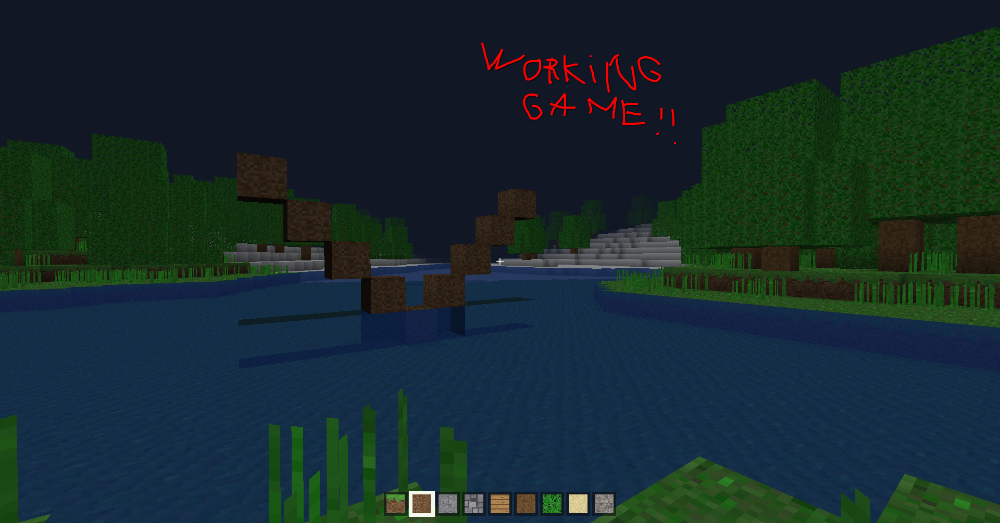

# VCraft

[](https://github.com/vlang/awesome-v)

A small Minecraft-like voxel sandbox written entirely in [V](https://vlang.io).
Procedural terrain, biomes, water, mining/building, a hotbar, and a HUD — no
Mojang assets, all textures are generated as pixel art at startup.



> **Disclaimer:** VCraft has only been tested on **CachyOS / Arch Linux**. It
> links against the system SDL2, EGL, OpenGL, and zlib libraries, so it may run
> on other modern Linux desktops, but nothing else has been verified. No
> Windows or macOS builds.

## Download

Direct download — grab the latest AppImage and run it:

```sh
wget https://github.com/gabytz777/vcraft/releases/latest/download/vcraft-x86_64.AppImage
chmod +x vcraft-x86_64.AppImage
./vcraft-x86_64.AppImage
```

More builds on the [releases page](https://github.com/gabytz777/vcraft/releases/latest).

> **Note:** GitHub downloads the file *without* the execute flag, so double-clicking
> may do nothing. If that happens, run the two commands above in a terminal.

## Build from source

Requires V (with the `gcc` backend) and the `SDL2`, `EGL`, `OpenGL`, and `zlib`
development packages. On Arch / CachyOS:

```sh
sudo pacman -S base-devel sdl2 mesa zlib   # then install V from vlang.io
git clone https://github.com/gabytz777/vcraft.git
cd vcraft
./build.sh          # -> build/vcraft
./build/vcraft
```

To produce your own AppImage:

```sh
./package.sh        # -> dist/vcraft-x86_64.AppImage
```

## Controls

`WASD` move · mouse look · `LMB` break · `RMB` place · `1-9` hotbar · `[` `]`
cycle · `space` jump · `shift` sneak · `ctrl` sprint · `F` fly · `Esc` quit.

## How it's built

- **All game logic is in V.** `src/` holds world generation, meshing, physics,
  raycasting, textures, and input handling.
- **100% V, zero C.** Every line of the project — game logic *and* the platform
  layer — is written in V. `src/ffi.v` binds SDL2, EGL, OpenGL, and zlib through
  V's FFI, so there is no C source anywhere in the repo.
- **Headless self-test.** An EGL surfaceless context plus synthetic input
  injection drive a full render + input + physics test with no window or human:

  ```sh
  EGL_PLATFORM=surfaceless VHEADLESS=1 VTEST=1 ./build/vcraft
  ```

  It prints a per-test line and `SELFTEST PASS`.
